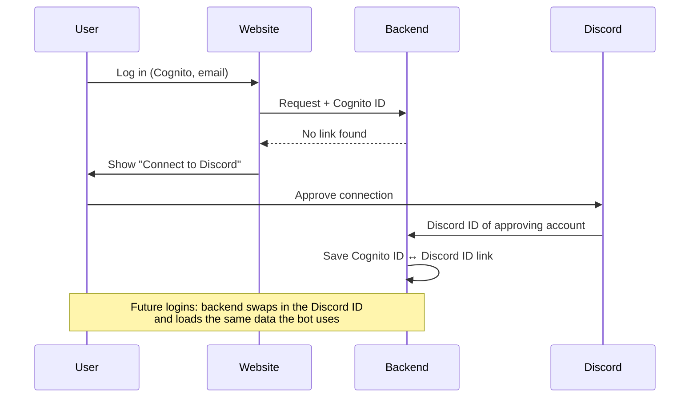

# Lapis

A Minecraft bot built around AWS Microservices that extends [Minecraft-based tooling](https://github.com/Cubitect/cubiomes).

Lapis has an [entire website](https://main.d15e4j6jt7lh3i.amplifyapp.com/).
Users can sign into this site(thanks to AWS Cognito) and store/retrieve locations and images of their own MC world. 

[Add Lapis to your Discord Server Here!](https://discord.com/oauth2/authorize?client_id=1342331009336868915&permissions=379904&integration_type=0&scope=bot)

You can think of Lapis as the younger, more complex sibling to [this](https://github.com/Greg-Vincent0711/Multi-purpose-Bot-for-Python/blob/main/DIscordBotVer%231.py) earlier project I made with a friend in 2021.

---

## Table of Contents

- [A Human's Perspective](#a-humans-perspective)
- [Overview](#overview)
- [Architecture](#architecture)
- [Encryption](#encryption)
- [Authentication](#authentication)
- [Infrastructure](#infrastructure)
- [Seed Features (C + Cubiomes)](#seed-features-c--cubiomes)
- [Building the C Code](#building-the-c-code)
- [Deploying the Backend](#deploying-the-backend)

---

## A Human's Perspective

*(tldr - I read all my code and wrote this out without an LLM... as nature intended)*

> **Disclaimer:** To get this project resume-ready (working and showable, since I had kind of abandoned it a year ago), I used Claude Code to speed up my remaining todos. I needed CRUD functionality to work across the website and bot, I needed the bot hosted on EC2, and I needed to fix any bugs I had. Since I had an express goal I wanted completed quickly, I leaned more into being a code reviewer than a writer. This nets serious productivity gains, and Lapis is resume-ready now: usable, hosted, etc. But it takes away from the creator's understanding of the code if they become too reliant on seeing things work without understanding how they work.

As such, I've thoroughly read through my code to write something that helps future devs (including me in a year) and potential employers see what I've created, and to make sure my understanding remains intact.

**Phase 2** of this project will be written completely by hand, with LLMs acting only as a guide for concepts or ideas I may struggle with. Should be fun.

A quick sidenote on the different phases...

For Phase 2 - I want to make a viewer akin to the Cubiomes-viewer that already exists and is used by MC seed finding projects - essentially a 2D map.
I want to extend it to work for modpacks like BetterMC(my current modpack of choice), and show users their saved coordinates and images overlaid onto a map. 

For Phase 3 - I want to take it a step further and build my own NBT viewer akin to [this one](https://www.shulkr.com/en) to work in tandem with the map. 

These two are subject to change, but that's the direction this project is moving in. 

---

## Overview

Lapis is split into two separate systems that interact with the same underlying AWS services:

| System | Description |
| --- | --- |
| **Discord Bot** | The primary interface. Manage locations and images and run seed lookups via commands. |
| **Frontend Site** | A web interface for the same data (still pending a domain). |

### `lapis.py`: the brains

`lapis.py` is the center of the operation. Everything except the website connects to it in some way. It:

- connects to the Discord library
- calls the SeedInfo function code as an executable
- calls the appropriate backend functions for CRUD operations on a user's locations and images
- uses the utility functions and UI features: embeds, paginators, docstrings, etc.

---

## Architecture

### Conceptually

Imagine an API request as water carrying pebbles of different sizes, poured into a drain with filters that catch different-sized objects.

In more grounded terms: as a request comes in, we examine its shape (its path), and the router matches it to the handler that fulfills it and executes that function. Every request "flows" through and is "caught" by the matching filter (the router running the request's matched handler). That is essentially what `db_lambda.py` and `router.py` do together, and they are two of the most important files on the backend.

### Codebase structure

The backend's organization is a deliberate separation of duties:

| Layer | Responsibility |
| --- | --- |
| `api/handler_methods` and `api/router` | Only deal with HTTP requests. This is what the site uses to interact with the functions provided. |
| `api/services/db.py` | Only deals with business logic between the AWS infrastructure responses and the response the bot needs. It doesn't know anything about AWS. |
| `api/repositories` | Only deals with AWS services: CRUD operations and user data encryption, for example. |

### Seed Lambda

`seed_lambda.py` is also part of the backend but deals solely with SeedInfo functions. This collection of routes is much less complex, so the code reads more like a chain of if-else statements. As Lapis grows in complexity (Phase 2), it may change to reflect the structure of `db_lambda.py`.

Right now, users can send a request to the Lambda for either a `nearest` or `spawn-near` request type. In purely API-side terms, these requests look for certain query params, call their respective handler functions, and return parseable JSON.

`seed_impl.py` and `subprocess.py` are the business-logic functions that bridge the gap between the C executable and a usable API response.

### Helpers

These Python files hold things like docstrings for commands, embeds for Discord UI styling, and some utility functions.

---

## Encryption

To add more security to this project (and step up my development game a bit), I've added server-side encryption of data at rest and in transit between client and server.

The general workflow (`encryption.py`, `key_generation.py`):

1. **Fernet (symmetric, nondeterministic).** The same value encrypted twice will not produce the same output. This means we can't use an encrypted location name, for example, to search for specific user data.
2. **SHA-256 (deterministic, not reversible).** Because the hash of a value is always the same, we can use it to *search* user data. It can't be reversed, which is why both Fernet encryption and hashing are needed.
3. **Key management.** To decrypt data when presenting it to the user, we need a specific key. It is stored in **AWS Secrets Manager** and fetched when needed (also cached).

The cool effect: user data stored in DynamoDB is completely unintelligible, yet when I send Lapis a command or log into the site, it's all readable.

---

## Authentication

*(see `oauth.py`)*

### On Discord

You may have noticed there's seemingly no way for users to log on or "sign up" when the bot is in a server. Every message a user sends is already implicitly connected to their author ID. The Discord API lets you grab `ctx.author.id` to differentiate messages and their origin. Lapis uses the system Discord already has.

### On the website

It's a little more complex, and it's where Cognito comes in:

1. Users sign up for the **Cognito User Pool** with an email. Cognito gives them a unique ID of their own, which isn't their Discord ID.
2. When they log in, the website sends that Cognito ID with every request. The backend looks for a saved "link" between this Cognito ID and a Discord ID.
3. The first time, there's no link yet, so the site shows a **"Connect to Discord"** button.
4. Clicking it sends the user to Discord, where they log in and approve the connection. Discord then tells the backend which Discord account just approved it, along with that account's Discord ID.
5. The backend saves a small record that says "this Cognito user is this Discord user."
6. From then on, every time they log into the site, the backend finds that record, swaps in their Discord ID, and loads the same locations and images they saved through the bot.



> Email is only used to log into the website. The two accounts are joined because Discord confirms who the user is.

---
## Infrastructure

It's no secret that Lapis is an AWS-based service, and managing many different AWS services can be a hassle. To keep that manageable, I maintain a CloudFormation template and recently had Claude Code create a `deploy.sh` script so any change I make can be deployed quickly across the application.

These two files act as the Infrastructure as Code portion of Lapis:

- `FormationTemplate.YAML`
- `deploy.sh` (where most of the configuration and tracking happens)
---

## Seed Features (C + Cubiomes)

[Cubiomes](https://github.com/Cubitect/cubiomes) is the C library I'm using and extending for my own C code. It's a dependency, tied to its own separate project. I'm still learning how Cubiomes works and the logic behind this sort of thing, as I was over a year ago when I wrote this with the help of an LLM. 

Essentially, a user can find:

- the **nearest biome** of their choosing
- the **nearest structure** of their choosing
- **seeds** with a spawn near some particular conditions


---

## Building the C Code

If someone wants to use the C code I wrote together with Cubiomes:

1. `cd` into `external/cubiomes`
2. Run `make`
3. `cd ../../src/SeedInfoFns`
4. Run `make`

```bash
cd external/cubiomes && make
cd ../../src/SeedInfoFns && make
```

---

## Deploying the Backend

All AWS resources are defined in [`src/lapis/FormationTemplate.YAML`](https://github.com/Greg-Vincent0711/Lapis/blob/master/src/lapis/FormationTemplate.YAML) (stack `LapisBackend`, `us-east-1`). From the repo root:

```bash
./deploy.sh --preview   # run the tests, build and upload the code, show what would change; changes nothing
./deploy.sh             # same, then asks before applying
```

The script reads the Discord client secret from `CLIENT_SECRET` in `.env`, and refuses any change that would delete or replace the DynamoDB table or the S3 bucket. `src/lapis/inputHandler` must be the Linux ARM build that Lambda runs.

When the website is hosted, add its domain:

```bash
SITE_ORIGINS="http://localhost:5173,https://<site>" \
DISCORD_REDIRECT_URI="https://<site>/auth/callback" \
./deploy.sh
```

> **Note:** The Fernet encryption key, the Cognito user pool, and the Python dependencies layer are deliberately kept outside the stack and passed in as parameters, so no stack change can delete them.
